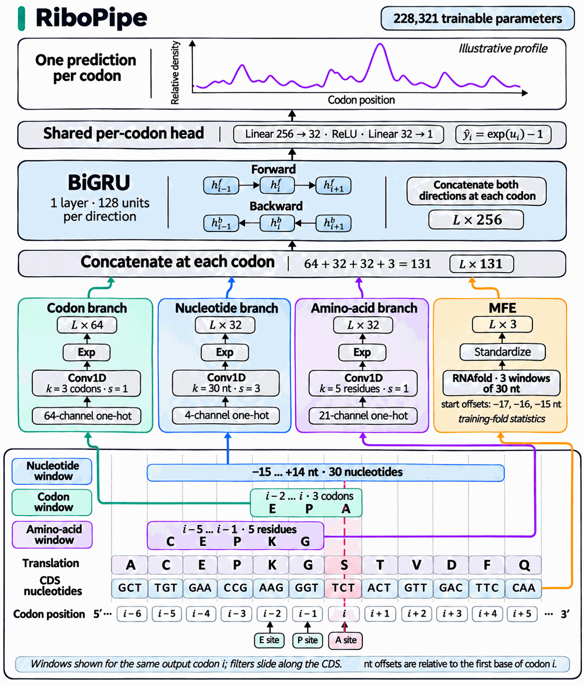

# RiboPipe

*A lightweight sequence-based predictor of relative footprint density for within-sample imputation of
low-coverage ribosome profiles.*

**Within-sample Ribo-seq imputation.** Within a sample, most transcripts have too few footprints to estimate how
ribosomes are distributed along them. RiboPipe learns local sequence patterns from the sample's own
high-coverage transcripts. It then predicts the relative footprint density, y = c / mean(c), along the sample's
low-coverage transcripts from sequence alone. A replicate library of the same sample shows the depth below which
the predicted profiles agree more closely with an independent measurement than the transcripts' own sparse reads
do. This is the crossover depth D\*.

> Version 2.0.0 accompanies the revised manuscript. It replaces 1.x (see [Previous versions](#previous-versions)).
> To reproduce every analysis of the manuscript, see **[docs/REPRODUCE.md](docs/REPRODUCE.md)**.

## Installation

```bash
git clone https://github.com/yaozhong/riboPipe
cd riboPipe
pip install .                 # numpy, scipy, torch
pip install ".[mfe]"          # + ViennaRNA, to compute folding energies for your own data
python tools/download_mfe.py  # folding-energy tracks of the released datasets (~74 MB, release assets)
```

Optional extras: `plot` (matplotlib, for the figures), `test` (pytest) and `baselines` (scikit-learn, for the
published comparators; see [`baselines/README.md`](baselines/README.md)). The exact versions used for the manuscript
are in [`requirements/paper-stack.txt`](requirements/paper-stack.txt).

This installs the **`ribopipe`** command-line tool and Python package. Python >= 3.10 and PyTorch >= 1.12 are
required. A GPU is optional: one cross-validation fold takes about 2 minutes on an RTX 4090.

## Data processing

RiboPipe consumes **per-codon A-site footprint counts** along CDSs. The released human datasets were processed
from reads with one pipeline and one annotation (GRCh38, GENCODE v46 basic):

| Step | Software | Settings |
|---|---|---|
| Trimming | fastp 0.23.4 | `-q 20 -n 10 -l 20` |
| UMI extraction | UMI-tools 1.1.6 | where the library has UMIs |
| rRNA removal | Bowtie2 2.5.4 | `--very-sensitive`, unaligned reads kept |
| Alignment | STAR 2.7.11b | local alignment, ≤ 2 mismatches, ≤ 10 loci, `--quantMode TranscriptomeSAM` |
| Deduplication | UMI-tools 1.1.6 | `dedup --method=unique`, where a UMI exists |
| P-site | riboWaltz 2.0 | offsets per read length (in-frame criterion) |
| A-site | | P-site counts shifted by one codon |

Each gene is represented by its longest standard ORF (start and stop codons annotated, no internal stop).
Transcripts with identical CDSs are counted once. The non-human datasets use the per-codon matrices released with
RiboMIMO.

**Your own sample.** Bring A-site-aligned CDS sequences (FASTA) and per-codon A-site counts (tab-separated:
`transcript`, `codon` (0-based), one column per replicate). Then run:

```bash
ribopipe prepare --fasta cds.fa --counts counts.tsv [--genes tx2gene.tsv] --out mydata --tag MySample
```

To try this end to end, `python examples/make_example_input.py --out example_input` writes such an input from a released
dataset.

`prepare` applies the rules used for the released data:

1. **High / low coverage.** Transcripts with more than 0.5 reads per nucleotide are high coverage (training and
   benchmark). All transcripts with at least one read form the low-coverage study population.
2. **Sequence-similarity units.** Genes whose CDSs share ≥ 20% of their 31-mers form one unit. A unit always stays
   on one side of a split.
3. **Folds.** Five folds over units. 10% of each fold's training units are held out for early stopping.
4. **Folding energies.** RNAfold MFE of the 30-nt window starting at every nucleotide (ViennaRNA), standardised
   with each fold's training windows.

## Quick start (released data)

```bash
ribopipe configs                                              # model configurations and parameter counts
ribopipe train --dataset GSE133393_WT --fold 0 --out runs/    # RiboPipe, seed 123, one fold
ribopipe cv5   --dataset GSE133393_WT --out runs/             # all five folds
ribopipe predict --ckpt runs/Paper_RiboPipe_MFE_H128/GSE133393_WT/seed123/fold0/model.pt \
                 --dataset GSE133393_WT --part partII --out pred.npz   # predict any transcripts of the dataset
```

Each run writes `<out>/<config>/<dataset>/seed<seed>/fold<fold>/`. The directory holds:
- `pred.npz`: relative footprint density of every test transcript;
- `model.pt`: a self-contained checkpoint;
- `train_log.json`;
- `run.json`.

For your own sample, point to the prepared directory:

```bash
RIBOPIPE_DATA=mydata RIBOPIPE_MFE=mydata/mfe ribopipe cv5 --dataset MySample --out runs/
```

## Model

<p align="center">
  
</p>

*At output codon i, the codon branch reads codons i−2 to i (E, P and A sites), the amino-acid branch reads residues
i−5 to i−1, and the nucleotide branch reads nucleotides −15 to +14 relative to the first base of codon i. The branch
outputs are concatenated with three standardised folding energies before the BiGRU. The density profile is
illustrative.*

RiboPipe has 228,321 parameters. Three convolutional branches feed one bidirectional GRU:
- **codon branch**: the E, P and A codons (one-hot, exponential activation);
- **nucleotide branch**: nucleotides −15..+14 relative to the first A-site nucleotide;
- **amino-acid branch**: the five residues preceding the A site.

The branch outputs and three footprint-scale folding energies (30-nt windows starting 17, 16 and 15 nt upstream of
the A site) enter the GRU (hidden 128). A small output layer then gives log1p(relative density).
**RiboPipe (−MFE)** is the same model without the folding energies.

Training uses a γ-weighted log-MSE, mean[(1+y)^0.5 (u − log1p y)²], with Adam (lr 1e-3) and early stopping on the
median per-transcript Pearson correlation of the validation transcripts. Test transcripts are predicted from
sequence and folding energies only. Their reads are never used.

## Low-coverage reliability (when to trust the predictions)

With two replicate libraries, compare the prediction and the sparse reads against the other replicate across
depth, and locate D\*:

```bash
ribopipe lowcov-predict --runs runs/ --dataset GSE133393_WT --out preds/   # out-of-fold predictions for all transcripts
ribopipe crossover --dataset GSE133393_WT --pred RiboPipe=preds/Paper_RiboPipe_MFE_H128/GSE133393_WT/pred.npz --out cross/
ribopipe crossover-summary --eval cross/GSE133393_WT/eval_GSE133393_WT.json --out cross/summary
```

The analysis covers both replicate assignments and similarity-unit bootstrap intervals. It also runs a
sequence-independent noise predictor as a control: at the lowest depths even noise can agree with the reference
more closely than sparse reads do.

`ribopipe posterior` combines the prediction with the reads. It uses the prediction as the prior of a
Dirichlet–multinomial posterior, with the prior strength chosen on high-coverage transcripts of other folds
(`ribopipe posterior-kappa`).

## Interpretability (what the trained model responds to)

```bash
ribopipe ism        --dataset GSE133393_WT --ckpt-dir runs/Paper_RiboPipe_MFE_H128/GSE133393_WT/seed123 --out ism/
ribopipe routing    --dataset GSE133393_WT --ckpt-dir ... --out routing/     # which branch carries each edit's effect
ribopipe transplant --dataset GSE133393_WT --ckpt-dir ... --out tp/ --subwindows
ribopipe logos      --dataset GSE133393_WT --ckpt-dir ... --out logos/ --device cuda:0
```

- **Single-codon and single-nucleotide edits** around predicted peaks, with folding energies recomputed or held
  fixed.
- **Branch routing** of each edit's effect.
- **Window transplantation**: the local window, its shuffled codons, and its parts, grafted into other transcripts.
- **Activation logos** of the first-layer filters, as an inspection tool.

These describe the trained model, not the cause of ribosome accumulation.

## Python API

```python
import torch
from ribopipe import data, train

ds = data.load_dataset("GSE133393_WT")                 # or load_dataset("MySample", data="mydata")
cfg = train.CONFIGS["Paper_RiboPipe_MFE_H128"]
dev = torch.device("cuda:0" if torch.cuda.is_available() else "cpu")
model, best, info = train.train_one(cfg, ds, fold=0, seed=123, dev=dev,
                                    train_ids=ds.train_ids(0), val_ids=ds.val_ids(0))
model.load_state_dict(best["native"][2])               # weights of the early-stopping epoch
pred = train.predict_transcripts(model, ds, ds.test_ids(0), cfg, dev)   # {transcript: relative density}

model, ckpt = train.load_ckpt("runs/Paper_RiboPipe_MFE_H128/GSE133393_WT/seed123/fold0/model.pt")
```

## Design and scope

- **Within-sample.** A model is trained and applied within one sample, so it can use the sample's own library
  characteristics. D\* depends on the sample, the predictor, the reference library and the transcripts scored.
  Estimate it with a replicate of your own sample.
- **Similarity-aware splits.** Folds keep similar coding sequences together, so accuracy is not inflated by
  near-duplicate transcripts.
- **Relative shape, not magnitude.** Predictions describe the profile shape within a transcript and the
  high-density codons it implies. They do not give absolute footprint load, individual peak heights (the
  strongest peaks are underestimated) or ribosome pausing strength.
- **Biology and library preparation.** Measured footprint density reflects both translation and library
  preparation, and the model learns both. Its responses near the footprint 5' end and to the folding energies may
  be technical.

## Data availability

`data/` holds the processed datasets (see [data/README.md](data/README.md)): per-codon counts, populations,
folds, similarity units and MFE normalisation.

| Dataset | Source | Notes |
|---|---|---|
| GSE233886_WT | GEO GSE233886 | two replicates |
| GSE133393_WT | GEO GSE133393 | two replicates |
| PRJNA_iPS | BioProject PRJNA976655 | two replicates |
| Subtelny14 | GEO GSE53268 | yeast |
| Mohammad16 | GEO GSE72899 | *E. coli* |
| Mohammad19-1, Mohammad19-2 | GEO GSE119104 | *E. coli* |
| TX9_WT (in-house HEK293T) | GEO GSE350848 | released on publication |

The folding-energy tracks are release assets (`python tools/download_mfe.py`).

## Repository layout

```
ribopipe/        data loader, network, training, ablations, evaluation, low-coverage analysis, model analyses, prepare
baselines/       wrappers that run the published methods and the in-house references (baselines/README.md)
data/            released datasets
paper_results/   result files of the manuscript, used to redraw its figures
reproduce/       figure scripts
docs/            REPRODUCE.md, assets/ (README figure)
requirements/    exact package versions of the manuscript (paper-stack.txt) and of the RiboExp/RiboGL environment
tests/           unit tests and the verification against the original analysis
tools/           data release builder, MFE download
```

## Previous versions

RiboPipe 1.x used a motif-CNN + BiGRU with about 0.35 M parameters, an optional magnitude head and the earlier
data and folds. It remains available as the tags `v1.1.0`, `v1.2.0` and `v1.2.1`. Checkpoints and data of 1.x do
not load in 2.0.0 (see [CHANGELOG.md](CHANGELOG.md)).

## License

MIT. See [LICENSE](LICENSE). The official code of the published methods is not redistributed:
`baselines/fetch_upstream.sh` downloads it from the original repositories at the commits used.
